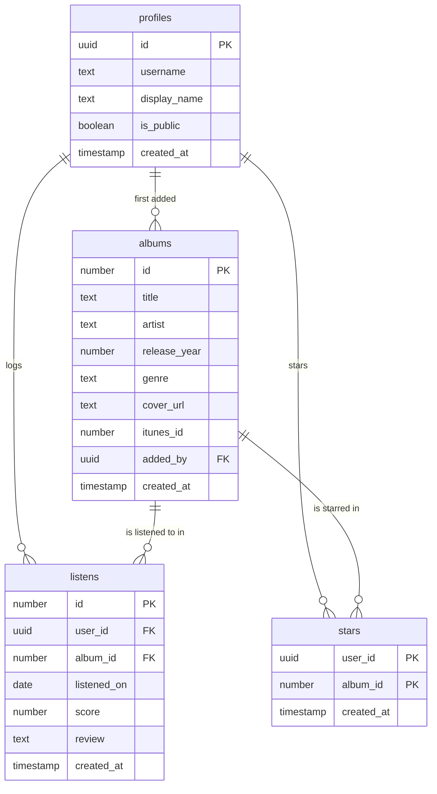

# PLAN.md — Recorded

*Working title. A diary for the albums I listen to.*

## 1. Pitch

I'm building **Recorded** because I listen to a lot of full albums but forget what I thought of them a few weeks later, and no album-rating app has stuck for me the way Letterboxd has for movies. Recorded lets me log every listen with a score out of 10 and a short review, keep a list of all-time favorites, and see my listening habits over time.

**How often I'll use it:** a few times a week (about 2–5 albums a week) for the rest of the semester.

## 2. Features

Numbered in the order I'll build them. Each one is its own Issue, branch, and pull request.

**Spine features**

1. **Sign up and login.** As a new visitor, I want to create an account with my email and a password, then log in and log out, so that my album diary is private to me.
2. **Data model.** As a listener, I want my albums, listens, and favorites saved to my account in a database, so that they're still there every time I come back, and nobody else can see them.
3. **Log, view, edit, and delete listens.** As a listener, I want to log a listen (album title, artist, release year, genre, the date I listened, a score from 1–10, and an optional review), see all my listens in a diary list, open one listen's detail page, edit it, and delete it after an "Are you sure?" confirmation, so that my diary is always accurate.
4. **Validation.** As a listener, I want a friendly message next to the field if I leave the album title, artist, listen date, or score blank, or enter a score that isn't a whole number from 1 to 10, so that I never save a broken entry.
5. **Stars (all-time favorites).** As a listener, I want to star an album to mark it as an all-time favorite and see all my starred albums on a Favorites page, so that I have a short list of the albums I love most, separate from individual scores.
6. **Find things.** As a listener, I want to search my diary by album or artist, filter by genre, and sort by newest, oldest, highest score, or lowest score, so that I can quickly find a past listen.
7. **Dashboard.** As a listener, I want a dashboard showing my total listens, my average score, and my top genre, plus a bar chart of listens per month, so that I can see my listening habits.

**My 3 features**

8. **iTunes album autofill.** As a listener, I want to type an album name, pick the right result from a list with cover art, and have the title, artist, release year, genre, and cover filled in for me, so that logging a listen takes seconds instead of typing everything.
9. **Random re-listen button.** As a listener, I want a button that picks a random album I've scored 8 or higher, so that I rediscover albums I loved but haven't played in a while.
10. **Public profile link.** As a listener, I want to turn on a public, read-only page at `/u/<my-username>` that shows my album covers, scores, reviews, and favorites, so that I can share my taste with friends who don't have an account.

## 3. Database

Five tables in Supabase (Postgres). Albums are a **shared list**: "In Rainbows" is saved once, and every user's listens point to it. Everything personal (listens, scores, reviews, stars) belongs to one user and is private.

**`profiles` (the users table).** One row per account, created automatically when someone signs up.

| Column | Type | Notes |
|---|---|---|
| `id` | text (uuid) | **Primary key.** Same id as the Supabase login account |
| `username` | text | Required, unique. Used in the public profile link |
| `display_name` | text | Optional |
| `is_public` | true/false | Default false. Turns the public profile link on or off |
| `created_at` | date/time | Set automatically |

**`albums` (the main item, shared by all users)**

| Column | Type | Notes |
|---|---|---|
| `id` | number | **Primary key**, auto-generated |
| `title` | text | Required |
| `artist` | text | Required |
| `release_year` | number | Optional |
| `genre` | text | Optional |
| `cover_url` | text | Optional. Cover image link from iTunes |
| `itunes_id` | number | Optional, unique. Stops the same iTunes album from being saved twice |
| `added_by` | text (uuid) | Links to `profiles.id`. Who first added it. Only this user can edit the album's details |
| `created_at` | date/time | Set automatically |

**`listens` (one row each time I listen to an album)**

| Column | Type | Notes |
|---|---|---|
| `id` | number | **Primary key**, auto-generated |
| `user_id` | text (uuid) | Links to `profiles.id`. Required |
| `album_id` | number | Links to `albums.id`. Required |
| `listened_on` | date | Required. I pick the date, so I can back-log past listens |
| `score` | number | Required. Whole number from 1 to 10 |
| `review` | text | Optional |
| `created_at` | date/time | Set automatically |

**`stars` (junction table for all-time favorites)**

| Column | Type | Notes |
|---|---|---|
| `user_id` | text (uuid) | Links to `profiles.id`. Part of the primary key |
| `album_id` | number | Links to `albums.id`. Part of the primary key |
| `created_at` | date/time | Set automatically |

The primary key is the pair (`user_id`, `album_id`), so a user can star an album only once. One table holds everyone's stars.

**How the tables connect**

- One user has many listens (`profiles` → `listens`: one-to-many).
- One album has many listens (`albums` → `listens`: one-to-many). Together, `listens` connects users and albums many-to-many.
- Users and albums are also connected many-to-many through `stars`.

**Privacy rules (Supabase Row Level Security).** Signed-in users can read albums, because album details aren't personal. Listens and stars can only be read, added, changed, or deleted by the user they belong to. The one exception: if a user turns on `is_public`, anyone can *read* (never change) that user's listens and stars on the public profile page.

## 4. Tests

1. **Data isolation.** *Given* User A has logged a listen of "In Rainbows" and User B has logged nothing, *when* User B signs in and loads their diary, *then* User B's list is empty, and asking the database directly for User A's listen by its id returns nothing.
2. **Dashboard stat (average score).** *Given* User A has listens scored 7, 8, and 10, and User B has one listen scored 2, *when* User A's dashboard stats are calculated, *then* User A's average score is 8.3 (25 ÷ 3, rounded to one decimal), and User B's listen doesn't change it.

Both tests run against a separate free Supabase **test** project, so they use the real privacy rules and never touch my real data.

## 5. Technologies

| What | Choice | Why |
|---|---|---|
| Coding agent | Claude Code | It can create branches, write code and tests, and open pull requests, which matches the feature loop. |
| Framework | Next.js (React + TypeScript) | Pages and server code live in one project, and it deploys to Vercel with no extra setup. |
| Database | Supabase (Postgres) | Real tables with relationships, plus Row Level Security so the database itself enforces "each user sees only their own data." |
| Sign up and login | Supabase Auth, email + password | New visitors sign up from inside the app. Email confirmation is turned off so the live demo sign-up works instantly. |
| Hosting | Vercel | Every merge into `main` redeploys automatically, so the live URL always stays current. |
| Album data | iTunes Search API | Free, needs no account or key, and returns cover art, genre, and release year. |
| Styling | Tailwind CSS | Fast to build a consistent dark theme without writing a separate stylesheet. |
| Chart | Recharts | A simple, popular React chart library for the listens-per-month bar chart. |
| Tests | Vitest | A fast test runner that works with TypeScript and can call Supabase directly. |

## 6. Design

- **Style:** dark and moody, so album covers are the most colorful thing on screen.
- **Colors:** near-black background (`#111214`), slightly lighter cards (`#1B1D21`), off-white text (`#F2F2F2`), gray secondary text (`#9A9CA3`), and one warm amber accent (`#F5A524`) for buttons, scores, and stars.
- **Layout:** album covers shown as a grid of square tiles. Each listen shows the cover, title, artist, date, and score badge. It works on a phone, since that's where I'll log most listens.
- **Type:** Inter, a clean sans-serif font.
- **Inspiration:** **Letterboxd** for the dark theme, the diary of entries, and the favorites row on a profile, and **Album of the Year** for showing scores prominently next to each album.

## 7. Risks and cuts

- **Least sure I can build:** the **public profile link**. It deliberately lets people without an account see some data, which goes against the main privacy rule. If the privacy rules are written wrong, it could leak private listens, and it must not break the data isolation test.
- **What I'll cut first:** the public profile link. If I run out of time, I'll replace it with a smaller third feature, such as a listening streak counter.
- **Other risks:**
  - The iTunes search could fail or return wrong matches. Manual entry always stays available as a fallback.
  - Free Supabase projects pause after a week without use. I'll use the app weekly and check that it's awake before the demo and grading.

---

## Plan vs. Reality

*Added Nov 3, 2026, after building. Everything above this line is the original plan, unchanged.*

Who made each call is in brackets: **(me)** means it was my decision; **(agent)** means the agent decided and I went along. The trail for each row is in the linked PR and its prompt log in [`prompts/`](prompts).

| Planned feature | Shipped / Changed / Cut | Status (Done/Backlogged) | Learning | What changed and why (one line) |
|---|---|---|---|---|
| 1. Sign up and login | Shipped | Done | Sign-up needs somewhere to store the username, so the users table can't wait | `profiles` table built in feature 1, not 2, because sign-up needed usernames **(agent)**. [#4](https://github.com/nolives/recorded/pull/4) |
| 2. Data model | Changed | Done | My plan said "five tables" but described four (plus Supabase's own login table) | Score made optional so I can log without rating **(me)**; review cap and undeletable shared albums **(agent)**. [#6](https://github.com/nolives/recorded/pull/6) |
| 3. Log, view, edit, delete listens | Shipped | Done | With a shared album list, only an album's first adder can edit its year and genre | As planned, including the "Are you sure?" before deleting. [#9](https://github.com/nolives/recorded/pull/9) |
| 4. Validation | Changed | Done | Checks must run on the server too: a score of 11 sent past the form was still rejected | "No score" allowed, because the score became optional **(me)**; date, year and length checks added **(agent)**. [#11](https://github.com/nolives/recorded/pull/11) |
| 5. Stars (Favorites page) | Shipped | Done | Holding an idea until a real user asks for it worked | Shipped as planned; a Favorite checkbox on the Log form added because the stranger test asked **(me)**. [#15](https://github.com/nolives/recorded/pull/15), [#35](https://github.com/nolives/recorded/pull/35) |
| 6. Find things | Shipped | Done | Anything a user types must be made harmless before it reaches the database | As planned; unscored listens sort last so they don't count as low scores **(me)**. [#19](https://github.com/nolives/recorded/pull/19) |
| 7. Dashboard | Changed | Done | My amber accent failed the chart color checks as a filled bar | Chart drawn without the planned Recharts, never discussed **(agent)**; deeper bar color to pass the checks **(agent)**. [#22](https://github.com/nolives/recorded/pull/22) |
| 8. iTunes album autofill | Changed | Done | Real use found what testing missed: iTunes couldn't find albums I was logging | Switched to MusicBrainz because iTunes missed *Perfecth* and *Reality Awaits* **(me)**; built 5th, not 8th **(me)**. [#13](https://github.com/nolives/recorded/pull/13), [#17](https://github.com/nolives/recorded/pull/17) |
| 9. Random re-listen button | Shipped | Done | "Haven't played in a while" needed a concrete rule before it could be built | Prefers albums scored 8+ not logged in 30 days, to match "in a while" **(agent)**. [#26](https://github.com/nolives/recorded/pull/26) |
| 10. Public profile link | Changed | Done | My riskiest feature was safest when visitors only reach data through checked database functions | Private / Link only / Public instead of on/off, so I can share by link **(me)**; one profile page **(me)**. [#28](https://github.com/nolives/recorded/pull/28) |

**Other parts of the plan**

| Planned | Shipped / Changed / Cut | Status (Done/Backlogged) | Learning | What changed and why (one line) |
|---|---|---|---|---|
| Section 2: build order | Changed | Done | Having real albums in the app made the later features easier to test | Autofill moved from 8th to 5th so I could log real albums sooner; the agent suggested it **(me)**. [#11](https://github.com/nolives/recorded/pull/11) |
| Section 4: a separate test project | Changed | Done | An honest red step for data isolation means really turning the privacy rules off | Tests use the live database and throwaway accounts, since only my data is in it **(me)**. [#30](https://github.com/nolives/recorded/pull/30), [#32](https://github.com/nolives/recorded/pull/32) |
| Section 5: iTunes API and Recharts | Changed | Done | Picking tools before using them with real data is a guess | MusicBrainz replaced iTunes **(me)** and Recharts wasn't used **(agent)**, for the reasons in rows 7 and 8. [#17](https://github.com/nolives/recorded/pull/17), [#22](https://github.com/nolives/recorded/pull/22) |
| Section 6: amber accent (`#F5A524`) | Changed | Done | Comparing real mockups beat picking a color in the abstract | Violet (`#A78BFA`) instead, picked after comparing five mockups **(me)**. [#24](https://github.com/nolives/recorded/pull/24) |
| Section 7: risks | Changed | Done | The feature I feared most shipped fine; the trouble came from a risk I'd called minor | iTunes "wrong matches" turned out to be missing albums, which took a whole data-source switch. [#17](https://github.com/nolives/recorded/pull/17) |

**Added after the plan**

| Not in the plan | Shipped / Changed / Cut | Status (Done/Backlogged) | Learning | What changed and why (one line) |
|---|---|---|---|---|
| Search by artist | Shipped | Done | Watching someone else use the app showed the search was hard to use | Added as my stranger-test fix, because it was their biggest struggle **(me)**. [#34](https://github.com/nolives/recorded/pull/34) |
| Favorite checkbox when logging | Shipped | Done | Small time-savers only show up when someone else uses the app | Added because it was the stranger test's second struggle **(me)**. [#35](https://github.com/nolives/recorded/pull/35) |
| Top 5 albums on the profile | Cut | Backlogged | A backlog Issue kept a good idea from growing a planned feature | Kept for later, because the Favorites shelf already covers it **(me)**. [Issue #7](https://github.com/nolives/recorded/issues/7) |
| A fuller home page | Cut | Backlogged | Not every struggle needs fixing now; logging works without it | Not fixed before the demo, because "bare-bones" is cosmetic and blocks no one **(me)**. |
