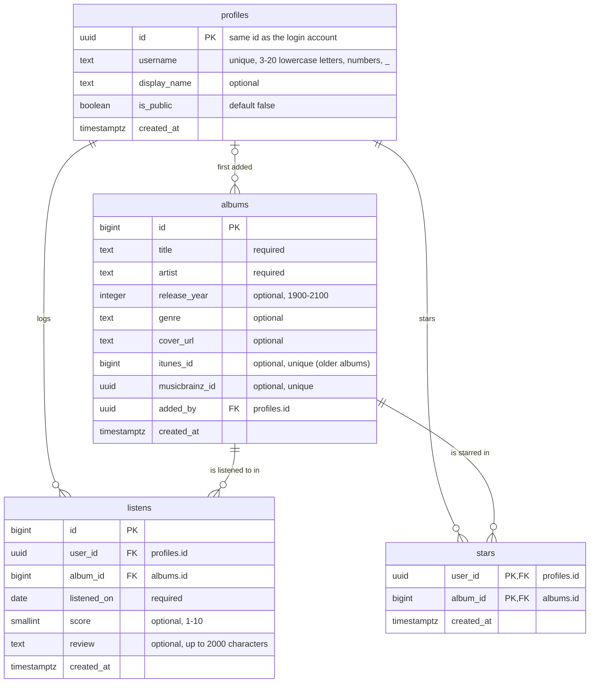

# schema.md — Recorded database

Recorded stores its data in **Supabase (Postgres)**. There are four tables:

| Table | What it is | Who can see it |
|---|---|---|
| `profiles` | The **users** table: one row per account | Only that user |
| `albums` | The **main item**: one shared list of albums | Any signed-in user |
| `listens` | The **related table**: one row each time a user listens to an album | Only the user who logged it |
| `stars` | The **junction table**: "this user starred this album" | Only the user who starred it |

The SQL that creates them lives in [`supabase/migrations/`](supabase/migrations/).

## Diagram

## Tables

### `profiles` (users)

| Column | Type | Rules |
|---|---|---|
| `id` | uuid | **Primary key.** Same id as the Supabase login account (`auth.users`). Deleting the account deletes the profile |
| `username` | text | Required, unique, 3–20 lowercase letters, numbers, or underscores |
| `display_name` | text | Optional |
| `is_public` | true/false | Defaults to false. Placeholder from the plan; feature 10 will replace it with a three-way sharing setting (see below) |
| `created_at` | date/time | Set automatically |

A database trigger creates the profile automatically when someone signs up, using the username they typed. Passwords are **not** stored here; Supabase keeps them hashed in its own `auth.users` table.

### `albums` (shared)

| Column | Type | Rules |
|---|---|---|
| `id` | number | **Primary key**, generated automatically |
| `title` | text | Required, can't be blank |
| `artist` | text | Required, can't be blank |
| `release_year` | number | Optional, between 1900 and 2100 |
| `genre` | text | Optional |
| `cover_url` | text | Optional. Cover image link (Internet Archive, via the Cover Art Archive; iTunes for older albums) |
| `musicbrainz_id` | uuid | Optional, **unique**, so the same MusicBrainz album can't be saved twice. Set when the album is picked from search |
| `itunes_id` | number | Optional, **unique**. Only on albums saved before search moved from iTunes to MusicBrainz |
| `added_by` | uuid | Links to `profiles.id`. Filled in automatically with whoever added it |
| `created_at` | date/time | Set automatically |

### `listens` (private)

| Column | Type | Rules |
|---|---|---|
| `id` | number | **Primary key**, generated automatically |
| `user_id` | uuid | Links to `profiles.id`. Filled in automatically with the signed-in user |
| `album_id` | number | Links to `albums.id`. Required |
| `listened_on` | date | Required. Chosen by the user, so past listens can be back-logged |
| `score` | number | **Optional.** If given, a whole number from 1 to 10. Unscored listens are left out of the average score, score sorting, and the random re-listen pick |
| `review` | text | Optional, up to 2,000 characters |
| `created_at` | date/time | Set automatically |

### `stars` (junction table, private)

| Column | Type | Rules |
|---|---|---|
| `user_id` | uuid | Links to `profiles.id`. Part of the primary key |
| `album_id` | number | Links to `albums.id`. Part of the primary key |
| `created_at` | date/time | Set automatically |

The **primary key is the pair** (`user_id`, `album_id`), so each user can star an album only once. Every user's stars live in this one table.

## How the tables relate

- **One user → many listens** (`profiles` → `listens`, one-to-many). Deleting a user deletes their listens.
- **One album → many listens** (`albums` → `listens`, one-to-many). An album can't be deleted while listens point to it.
- **Users ↔ albums, many-to-many, two ways:**
  - through `listens` ("this user listened to this album on this date")
  - through `stars` ("this user starred this album")
- **One user → the albums they first added** (`profiles` → `albums`, via `added_by`). If that user is deleted, the album stays and `added_by` becomes empty.

## Privacy rules (Row Level Security)

Each table has Row Level Security turned on. The database itself checks who is asking before returning or changing any row.

| Table | Read | Add | Edit | Delete |
|---|---|---|---|---|
| `profiles` | Own row only | (Created automatically at sign-up) | Own row only | — |
| `albums` | Any signed-in user | Any signed-in user (recorded as added by them) | Only the user who added it | Nobody |
| `listens` | Own rows only | Only as yourself | Own rows only | Own rows only |
| `stars` | Own rows only | Only as yourself | — | Own rows only |

Logged-out visitors can't read any table. The only exception is a small `username_available` function that the sign-up form uses to check whether a username is taken.

## Compared with PLAN.md section 3

| Planned | Built | Same? |
|---|---|---|
| `profiles` users table with `id`, `username`, `display_name`, `is_public`, `created_at` | Same columns. Built in **feature 1** instead of feature 2, because sign-up needed it | Yes, built earlier |
| `albums` with title, artist, release year, genre, cover URL, iTunes id, added by | Same columns, plus `musicbrainz_id` | **Changed** (my decision after real use): iTunes search couldn't find some albums I logged, like *Perfecth* and *Reality Awaits*, so search moved to MusicBrainz. `itunes_id` stays for albums saved before the switch |
| Only the user who added an album can edit its details | Enforced by a privacy rule | Yes |
| `listens` with date, **required** score 1–10, optional review | Same columns, but the **score is optional** | **Changed** (my decision during feature 2): I want to log an album I listened to without scoring it yet |
| — | `review` limited to 2,000 characters | **Added**: a safety limit not in the plan |
| — | Albums can't be deleted by anyone | **Added**: the plan didn't say. Albums are shared, so deleting one could break other users' listens |
| `stars` with (user, album) as the primary key | Same | Yes |
| Signed-in users can read albums; listens and stars are private | Enforced by Row Level Security | Yes |
| Public profile on/off with `is_public` | **Changed** (my decision during feature 2): three settings instead, **Private**, **Link only** (a secret, resettable link), or **Public** (`/u/username`). Built in feature 10 | Not yet built |
